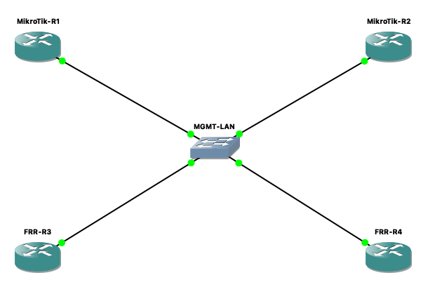

# Thông số và cấu hình lab tuần 1

Tài liệu ghi lại thiết lập đã dùng ngày 31/10/2026. Các lệnh cấu hình dưới đây được tổng hợp lại từ phiên console, không phải bản backup đầy đủ. Không chạy lặp lệnh thêm IP trên router đã có địa chỉ tương ứng.

## 1. Môi trường và tài nguyên

| Thành phần | Thiết lập đã dùng |
|---|---|
| Host | macOS, Apple M1, RAM vật lý 8 GB |
| GNS3 | 2.2.61, backend local |
| QEMU ban đầu | 2.10.1 x86-64 đi kèm GNS3 |
| QEMU cuối phiên | 11.1.3 ARM64, cài bằng Homebrew |
| Binary dùng cho node | `/opt/homebrew/bin/qemu-system-x86_64` |
| Options | `-nographic -machine accel=tcg` |
| Console cuối cùng | Telnet console GNS3 trên localhost |
| Kiểu đĩa node | Linked clone, đĩa riêng cho từng router |
| RAM guest khai báo | 2 × 1024 + 2 × 256 = 2560 MB; chưa bao gồm overhead host |

QEMU chạy native trên ARM64, nhưng guest trong lab là x86-64 được giả lập bằng TCG. Không gọi đây là ảo hóa x86 tăng tốc phần cứng trên M1.

## 2. Image và nguồn tải

| Image | Nguồn | Kiểm tra đã thực hiện |
|---|---|---|
| `chr-7.23.8.img` | [MikroTik CHR 7.23.8 ZIP](https://download.mikrotik.com/routeros/7.23.8/chr-7.23.8.img.zip) | Giải nén được; kích thước 134217728 byte; CLI báo 7.23.8 long-term |
| `frr-8.2.2.qcow2` | [GNS3 QEMU Appliances](https://downloads.sourceforge.net/project/gns-3/Qemu%20Appliances/frr-8.2.2.qcow2) | MD5 khớp manifest GNS3 |

MD5 FRR: `45cda6b991a1b9e8205a3a0ecc953640`. [Manifest đối chiếu](https://raw.githubusercontent.com/GNS3/gns3-registry/master/appliances/frr.gns3a).

MD5 CHR do GNS3 ghi nhận: `a78a34db4870c9c2dcde689b5c3d63d0`. Đây là giá trị ghi nhận trên máy, **chưa đối chiếu với checksum do MikroTik công bố**.

Image nằm trong thư mục `~/GNS3/images/QEMU/` trên máy thực hiện. Mỗi nền tảng dùng một image gốc để tạo hai node độc lập.

## 3. Template

| Thuộc tính | MikroTik | FRR |
|---|---|---|
| Tên template | MikroTik CHR 7.23.8 - M1 test | FRR 8.2.2 - M1 lab |
| vCPU | 1 | 1 |
| RAM | 1024 MB | 256 MB |
| Adapters | 2 | 2 |
| Card mạng | virtio-net-pci | e1000 |
| Disk interface | virtio | ide |
| Guest platform | x86_64 | x86_64 |
| Console | telnet | telnet |

## 4. Topology và địa chỉ



| Node | Cổng GNS3 | Cổng guest | Cổng switch | IP |
|---|---|---|---|---|
| MikroTik-R1 | Adapter 0 | ether1 | 0 | 192.168.77.11/24 |
| MikroTik-R2 | Adapter 0 | ether1 | 1 | 192.168.77.12/24 |
| FRR-R3 | Adapter 0 | eth0 | 2 | 192.168.77.13/24 |
| FRR-R4 | Adapter 0 | eth0 | 3 | 192.168.77.14/24 |

Subnet `192.168.77.0/24`, netmask `255.255.255.0`. Phép thử cùng subnet không cần default gateway. Chưa thiết lập gateway ra ngoài hoặc đường truy cập từ Mac.

Cổng console được cấp trong phiên: R1 localhost:5009, R2 localhost:5001, R3 localhost:5004, R4 localhost:5006. Đây là **console Telnet do GNS3 cung cấp**, không phải cổng SSH của router và có thể thay đổi khi dựng lại. Nên mở console từ giao diện GNS3.

## 5. Lệnh cấu hình đã dùng

### MikroTik-R1

```routeros
/system identity set name=MikroTik-R1
/ip address add address=192.168.77.11/24 interface=ether1 comment=M1-LAB
/ip address print
/system resource print
/export file=baseline
```

### MikroTik-R2

```routeros
/system identity set name=MikroTik-R2
/ip address add address=192.168.77.12/24 interface=ether1 comment=M1-LAB
/ip address print
/system resource print
/export file=baseline
```

Mật khẩu được thiết lập riêng ở lần đăng nhập ban đầu, không nằm trong các đoạn lệnh công bố.

### FRR-R3 — nhập tại vtysh

```text
configure terminal
hostname FRR-R3
interface eth0
ip address 192.168.77.13/24
no shutdown
end
write memory
show interface brief
show version
```

### FRR-R4 — nhập tại vtysh

```text
configure terminal
hostname FRR-R4
interface eth0
ip address 192.168.77.14/24
no shutdown
end
write memory
show interface brief
show version
```

`write memory` ở đây lưu cấu hình FRR; không phải sao lưu toàn bộ hệ điều hành Linux.

## 6. Dựng lại mô hình

1. Chuẩn bị GNS3 và backend phù hợp với máy. Các thông số trên là thiết lập đã thử trên M1; vẫn phải xử lý vấn đề ổn định nêu trong báo cáo.
2. Trên máy M1 thực hiện trước đó, QEMU được cài bằng `brew install qemu`. Nếu cài ở thời điểm khác, ghi nhận phiên bản thực tế; lệnh này không cố định phiên bản 11.1.3.
3. Tải hai image từ nguồn ở trên, kiểm tra checksum FRR, giải nén CHR và đặt image vào kho QEMU.
4. Trong GNS3, tạo hai QEMU template theo bảng thông số. Chọn QEMU binary phù hợp với máy; riêng M1 đã dùng đường dẫn Homebrew ở trên và options TCG.
5. Tạo project `Network-Backup-M1-Smoke-Test`; thêm hai node mỗi template, một Ethernet switch, nối cổng đầu tiên của từng node.
6. Khởi động từng node, mở console, tự thiết lập tài khoản riêng; áp cấu hình tương ứng.
7. Chạy các lệnh ping trong [kết quả kiểm thử](KET_QUA_KIEM_THU.md). Ghi kết quả mới riêng, không dùng số liệu trong repo làm bằng chứng cho một lần chạy khác.
8. Lưu cấu hình và dừng router sau khi dùng.

Project gốc vẫn nằm trong thư mục GNS3 projects của máy thực hiện. Repo này cung cấp hướng dẫn dựng lại, **không phải portable project đã đóng gói kèm đĩa**.
