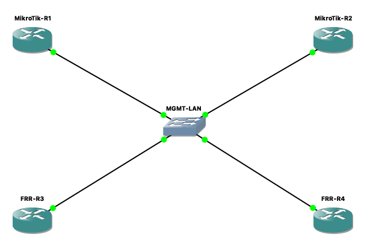

# TV2 — Báo cáo nhiệm vụ tuần 1

**Đề tài:** Hệ thống sao lưu và khôi phục cấu hình thiết bị mạng tập trung.
**Thực hiện lab:** 31/10/2026. **Tổng hợp báo cáo:** 01/11/2026.
**Môi trường thực tế:** Mac Apple M1, RAM 8 GB.

**Kết quả:** đã dựng 2 MikroTik CHR và 2 FRRouting trong GNS3, cấu hình mạng quản trị nội bộ và kiểm tra R1 ping tới ba router còn lại thành công. **Tuần 1 chưa đủ điều kiện nghiệm thu:** chưa kiểm thử SSH từ Mac/Python đến thiết bị, chưa có liên kết dữ liệu/OSPF và còn lỗi kernel/tự khởi động lại trên MikroTik.

## Nội dung

| Tài liệu | Nội dung |
|---|---|
| [Báo cáo chi tiết tuần 1](BAO_CAO_CHI_TIET.md) | Mục tiêu, cách thực hiện, kết quả và giới hạn của từng nhiệm vụ |
| [Thông số và cấu hình lab](CAU_HINH_LAB.md) | Image, QEMU, topology, IP, lệnh đã dùng và cách dựng lại |
| [Kết quả kiểm thử](KET_QUA_KIEM_THU.md) | Minh chứng phiên bản, IP, lưu cấu hình và ping |
| [Tồn đọng và tiêu chí nghiệm thu](TON_DONG.md) | Lỗi, trạng thái xử lý, việc cần hoàn thành trước tuần 2 |
| [Dữ liệu kết quả ping](ping-summary.json) | Số gói gửi/nhận, mất gói và độ trễ của phép thử thực tế |
| [Ảnh topology](topology.png) | Ảnh chụp mô hình trong GNS3 |

## Phạm vi bàn giao

Đây là hồ sơ tuần 1, không phải triển khai adapter Python của TV2. Các script hỗ trợ dựng lab qua API GNS3/console chưa phải `MikroTikDevice` hoặc `FRRDevice` sử dụng Netmiko.

Hồ sơ gồm tài liệu, lệnh cấu hình đã dùng, minh chứng đã rà soát và nguồn tải image. Project GNS3 cùng đĩa thiết bị đã cấu hình vẫn nằm trên máy thực hiện. Không có image, đĩa VM chứa tài khoản, mật khẩu, file `.env`, backup thiết bị hoặc log vận hành nguyên bản trong thư mục này. Các thành viên có thể dựng lại theo tài liệu và tự thiết lập tài khoản lab.

Phần lập trình tiếp theo cần tuân theo [API contracts của TV1](../docs/API_CONTRACTS.md); hồ sơ này không thay đổi interface của project.
